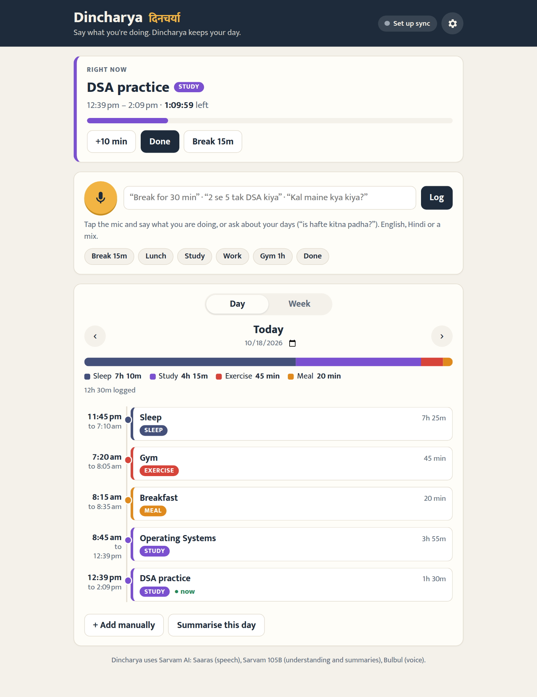
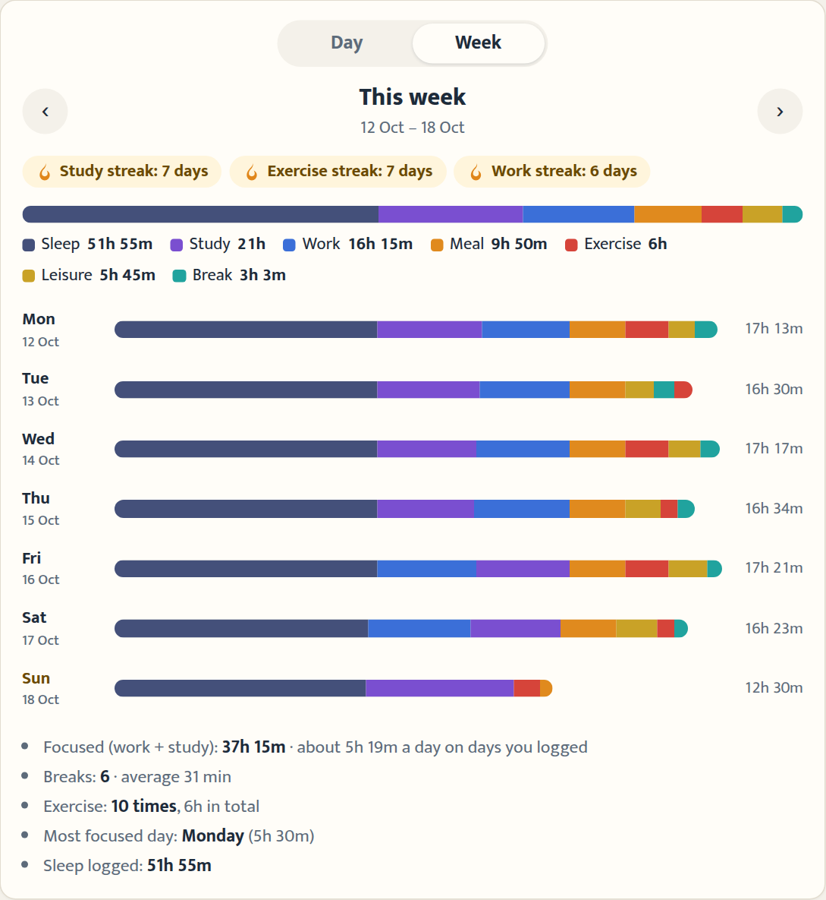
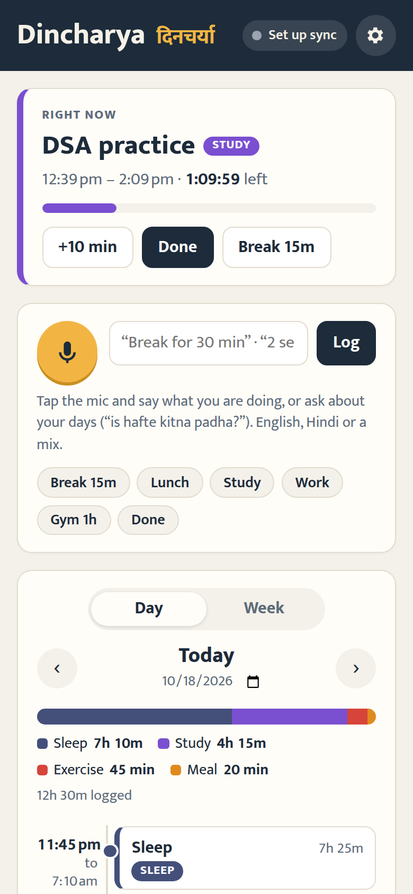

# Dincharya (दिनचर्या)

**Say what you're doing. Dincharya keeps your day.**

*Dincharya (दिनचर्या) means "daily routine" in Hindi.*

**Live:** https://mydincharya.vercel.app

A voice-first log of your day. Speak naturally, in English, Hindi or Hinglish, and Dincharya turns it into a timeline you can look back on, day by day.

## What you can say

| You say | Dincharya records |
|---|---|
| "Taking a break for half an hour" | Break, now → 30 min from now, with a countdown |
| "Ab 3 ghante DSA karungi" | DSA practice, now → 3 hours from now |
| "Lunch kar rahi hoon" | Lunch from now, until you start the next thing |
| "2 se 5 tak project pe kaam kiya" | Project work, 2:00–5:00 pm |
| "Subah 7 se 8 gym, phir 8:30 tak nashta" | Gym 7–8, breakfast 8–8:30 |
| "Kal raat 11 se 7 tak soyi" | Sleep, last night 11 pm → 7 am |
| "Done" / "break khatam" | Ends whatever is running |
| "Is hafte gym kitni baar gayi?" | Answers out loud: "Is hafte ab tak aap 4 baar gym gayi hain." |

## Features

- **Right now card:** what you're doing, with a live timer or countdown. When a break runs out, it chimes and offers **Back to DSA** (whatever the break interrupted).
- **Day timeline:** every activity with times and durations, gaps you didn't log, and time per type (study, work, meals, breaks, sleep…). Go back to any date.
- **Week view and streaks:** time per day and per type, focused hours, average break length, most focused day, and streaks like "Study streak: 7 days". Tap a day to open it.
- **Ask your log:** "kal maine kya kiya?", "how much did I study this week?", answered out loud from your own data.
- **Gentle nudges:** a long break, a missed lunch or dinner, 2+ hours without a break, or nothing logged for a while.
- **Install it:** add it to your phone's home screen like an app; it opens offline and shows alerts as notifications.
- **Summarise this day:** a short spoken review of your day with one suggestion for tomorrow.
- **Edit anything, undo anything:** tap an activity to fix it, or undo the last change.
- **Sign in with Google:** each person gets their own private log, saved to a Postgres database and the same on every device. The browser keeps a copy, so it works offline and syncs when you're back online.
- **Your data, your call:** download everything as JSON, sign out (the device forgets the log), or delete your account and all its data.
- **Hindi or English:** speak either or mix them; replies come back in the language you pick.

## Screenshots



| Week view with streaks | On a phone |
|---|---|
|  |  |

## Sarvam AI models used

| Model | Used for |
|---|---|
| Saaras v4 | Speech to text, auto-detecting the language |
| Sarvam 105B | Turning sentences into activities and times, answering questions about your log, writing the day summary |
| Bulbul v3 | Speaking replies and summaries |

**When Sarvam credits run out:** every AI call falls back automatically to free providers: Groq (gpt-oss-120b for understanding, Whisper for speech-to-text) and Google Gemini (Flash as a second chat model, Flash TTS for voice). If no voice comes back, the phone reads the reply aloud itself. Set `AI_PROVIDER=free` to skip Sarvam entirely.


## Run locally

```bash
npm install
cp .env.example .env      # SARVAM_API_KEY (+ optional GROQ/GEMINI keys), DATABASE_URL, GOOGLE_CLIENT_ID, SESSION_SECRET
npm start
```

Open http://localhost:3000. For local testing without Google, set `DEV_LOGIN=1` to get a test sign-in button. Without `DATABASE_URL` the log stays in the browser.
